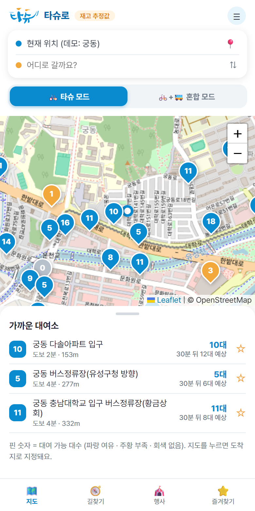
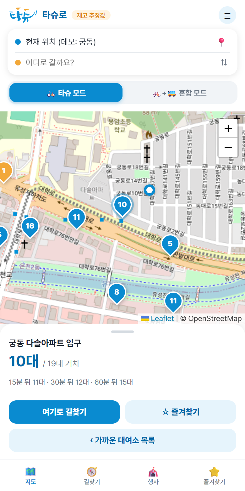
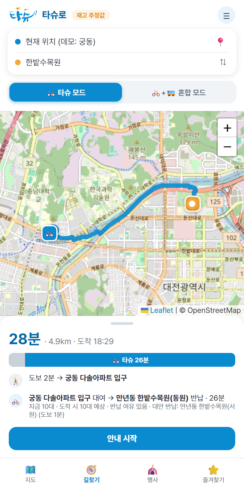
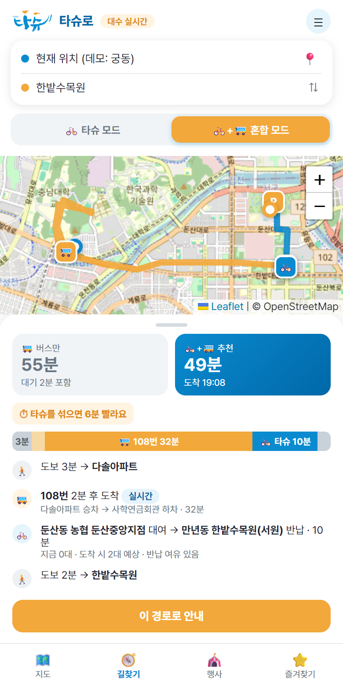
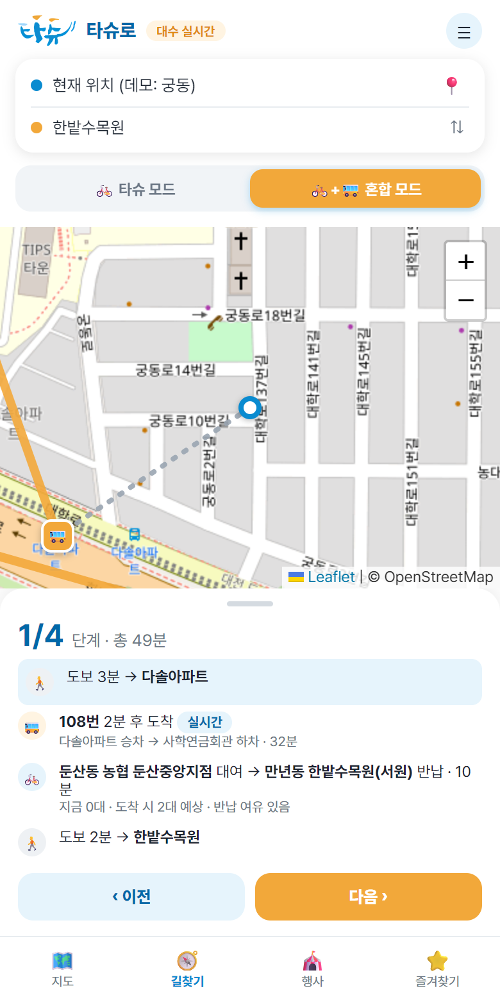
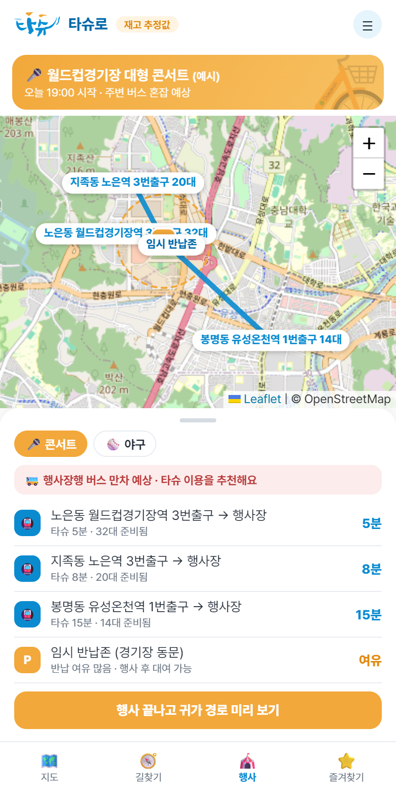
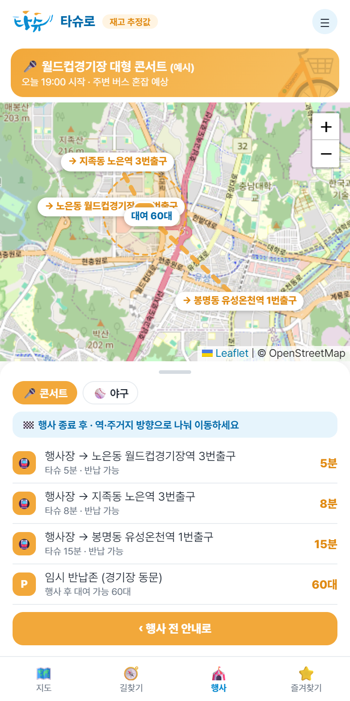
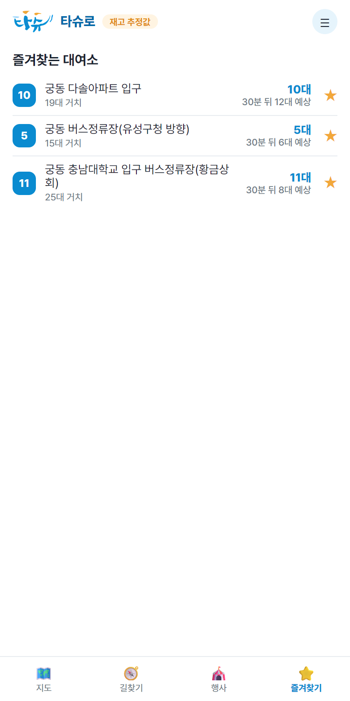

# 타슈로 (路)

타슈로는 대전의 공영자전거 "타슈"와 시내버스를 함께 써서 길을 찾아 주는 모바일 웹 서비스입니다.
"버스가 안 올 때, 이미 깔려 있는 무료 자전거를 타면 더 빠를까?"라는 질문에 답해 줍니다.

대전 시민 참여 아이디어 기획전 제안서를 바탕으로 만든 시범 구현입니다.
이 문서는 먼저 왜 만들었는지 설명하고, 화면과 기능, 계산 방법, 서버 구조, 실행 방법 순서로 이어집니다.

## 목차

1. 왜 만들었나
2. 무엇을 해결하나
3. 화면과 기능
4. 어떻게 계산하나
5. 전체 구조 (데이터와 API 흐름)
6. 폴더 구성
7. 실행 방법
8. 지금 어디까지 됐나
9. 추진 계획과 기대 효과

---

## 1. 왜 만들었나

### 대중교통이 닿지 않는 곳이 많다

- 대전의 도시철도는 1호선 하나뿐입니다. 그래서 많은 지역이 시내버스에 기대고 있습니다.
- 어떤 노선은 버스가 오는 간격이 깁니다. 버스를 한 번 놓치거나 갈아타야 하면 가까운 거리도 오래 걸립니다.

### 버스가 가득 차도 알려 주는 곳이 없다

- 출퇴근 시간이나 큰 행사 때는 버스가 만차가 됩니다.
- 그럴 때 다른 이동 방법을 알려 주는 서비스가 부족합니다.

### 지도 앱은 타슈를 잘 모른다

- 타슈는 무료이고, 대전 곳곳에 대여소가 있습니다.
- 하지만 기존 지도 앱의 자전거·대중교통 길찾기에는 타슈 대여소 위치와 남은 자전거 수가 충분히 들어 있지 않습니다.
- 그래서 시민이 직접 대여소를 찾고, 자전거가 있는지 확인하고, "버스 대신 타슈가 더 빠를까?"를 혼자 판단해야 합니다.

### 제안자의 경험

대전에서 열린 큰 콘서트에 갔을 때 행사장으로 가는 버스가 가득 차서 많은 관객이 타지 못했고, 이동이 늦어졌습니다.
근처에 타슈 대여소가 있었지만 어디서 빌려서 어떤 길로 가야 할지 알기 어려웠습니다.

### 이미 가진 자료

- 2026년 기준 타슈 대여소 위치 자료

이 자료로 대여소별, 시간대별 이용 패턴을 분석하고, 버스 정류장 근처의 "환승 거점" 후보를 찾을 수 있습니다.
(이용내역은 아직 이 저장소에 들어 있지 않습니다. 8장을 보세요.)

---

## 2. 무엇을 해결하나

| 문제 | 타슈로의 방법 |
|---|---|
| 버스 배차 간격이 길어서 오래 기다린다 | 오래 기다리는 구간을 타슈로 바꾼 "혼합 경로"를 보여 준다 |
| 버스를 타기 어려울 때 대안이 없다 | 같은 목적지까지 타슈로만 가는 경로와 시간을 보여 준다 |
| 기존 길찾기가 타슈 재고를 모른다 | 대여소의 남은 자전거 수를 반영해 빌릴 곳과 반납할 곳을 추천한다 |

### 다른 서비스와 무엇이 다른가

| 구분 | 일반 지도 앱 자전거 길찾기 | 일반 대중교통 길찾기 | 타슈로 |
|---|---|---|---|
| 타슈 대여소 반영 | 안 함 | 안 함 | 함 |
| 남은 자전거 수 | 안 함 | 안 함 | 함 (타슈 API 키가 있으면 실시간, 없으면 추정값) |
| 도착할 때 반납 자리가 있을지 | 안 함 | 안 함 | 예상해서 알려 줌 |
| 타슈와 버스를 섞은 경로 | 지원 안 함 | 지원 안 함 | 지원 |
| 시간 비교 | 자전거 중심 | 대중교통 중심 | 버스만 vs 혼합을 나란히 비교 |

### 핵심 아이디어 한 줄

새로 설치할 것은 없습니다. 필요한 것은 "언제, 어디서 타슈를 타면 이득인지 알려 주는 안내"입니다.
타슈는 무료라서 요금을 비교할 필요 없이 시간만 비교하면 됩니다.

---

## 3. 화면과 기능

아래 사진은 `node server.js`로 서버를 실행한 뒤, 실제 화면을 휴대폰 크기(가로 390px)로 찍은 것입니다.
출발지는 위치 권한이 없을 때 쓰는 "데모 위치(궁동)"입니다.
화면 위쪽의 표시는 남은 자전거 수가 어디서 왔는지 알려 줍니다. "재고 추정값"은 추정한 값이고, "대수 실시간"은 타슈 Open API에서 받은 값입니다.
아래 사진은 타슈 API 키를 연결하기 전에 찍어서 "재고 추정값"으로 나옵니다.

아래쪽에는 항상 탭 4개가 있습니다: 지도, 길찾기, 행사, 즐겨찾기.

### 3-1. 지도: 가까운 대여소 보기



- 지도에 대여소가 핀으로 표시됩니다. 핀의 숫자는 지금 빌릴 수 있는 자전거 수입니다.
- 색깔은 남은 정도를 뜻합니다. 파랑은 여유(5대 이상), 주황은 부족(1~4대), 회색은 없음(0대)입니다.
- 아래 목록에는 내 위치에서 가까운 대여소 3곳이 나옵니다. 걸어서 몇 분 걸리는지, 30분 뒤에 몇 대가 남을지 예상도 함께 보여 줍니다.
- 지금은 자전거가 있지만 30분 뒤에는 1대 이하로 줄 것 같으면 "곧 소진 예상"이라고 알려 줍니다.
- 별 모양 버튼을 누르면 즐겨찾기에 담깁니다.
- 지도는 14단계 이상 확대해야 대여소가 보입니다. 대여소가 1,300개가 넘어서, 화면 안에서 가까운 120개만 그립니다.



- 핀이나 목록을 누르면 그 대여소의 자세한 정보가 나옵니다. 지금 대수, 전체 거치대 수, 15분, 30분, 60분 뒤 예상 대수입니다.
- "여기로 길찾기"를 누르면 그 대여소를 도착지로 정하고 길찾기 탭으로 넘어갑니다.

### 3-2. 도착지 정하기

- 위쪽 입력칸에 장소 이름을 쓰면 자동완성이 뜹니다. 대표 장소 8곳과 대여소 이름을 검색할 수 있습니다.
- 지도를 눌러서 직접 정할 수도 있습니다. 마지막으로 눌러 둔 입력칸(처음에는 도착지)에 들어갑니다.
- 출발지 칸의 지도 핀 버튼은 지금 내 위치를 가져옵니다. 위치 권한이 없거나 대전 밖이면 데모 위치(궁동)를 씁니다.
- 위아래 화살표 버튼은 출발지와 도착지를 서로 바꿉니다.
- 아래 시트 맨 위의 작은 막대를 누르면 시트를 접었다 펼 수 있습니다.

### 3-3. 모드 1: 타슈 모드 (처음부터 끝까지 타슈)



흐름은 이렇습니다.

```
출발지 -> (걷기) -> 출발 대여소 -> (타슈) -> 도착 대여소 -> (걷기) -> 목적지
```

- 가장 가까운 대여소가 아니라, 내가 도착했을 때 자전거가 남아 있을 대여소를 출발지로 고릅니다.
- 도착할 때 반납할 자리가 있을 대여소를 도착지로 고릅니다.
- 맨 위에 총 시간, 거리, 도착 시각이 나옵니다. 가운데 막대는 걷기와 타슈가 각각 몇 분인지 보여 줍니다.
- 반납할 대여소가 꽉 찰 경우를 대비해, 근처의 다른 반납 대여소를 대안으로 함께 알려 줍니다(도보 몇 분인지 포함).
- 출발 대여소의 자전거가 적을 것 같으면 "출발 대여소 재고가 적어요"라는 경고가 뜹니다.
- 지도의 파란 선이 자전거 경로입니다.

### 3-4. 모드 2: 혼합 모드 (타슈와 버스 같이 타기)



흐름은 이렇습니다.

```
출발지 -> (타슈) -> 정류장 -> (버스) -> 목적지 근처 -> (걷기나 타슈) -> 목적지
```

- 위쪽에 "버스만 이용"과 "타슈+버스"의 시간이 나란히 나옵니다. 위 사진에서는 58분과 50분입니다.
- 혼합이 3분 이상 빠를 때만 추천합니다. 그보다 차이가 작으면 "버스만 이용하는 편이 좋아요"라고 알려 줍니다.
- 버스 단계에는 "실시간" 또는 "추정" 표시가 붙습니다. 실시간은 대전시 버스 도착정보에서 가져온 시간이고, 추정은 배차 간격으로 계산한 값입니다.
- 이 모드에서 타슈로 바꾸는 경우는 두 가지입니다.
  - 버스 정류장까지 걷는 길이 길거나, 버스를 오래 기다려야 할 때: 중간 정류장까지 타슈로 가서 거기서 버스를 탑니다.
  - 버스에서 내린 뒤 목적지까지 걷는 길이 길 때: 내린 정류장 근처에서 타슈를 빌려 목적지 근처에 반납합니다.
- 타슈 구간은 파랑, 버스 구간은 주황, 걷기는 회색으로 보입니다.

### 3-5. 안내 시작



- "안내 시작"(혼합 모드에서는 "이 경로로 안내")을 누르면 단계별 안내가 시작됩니다.
- 현재 단계가 하이라이트되고, 지도가 그 단계의 위치로 이동합니다.
- "이전", "다음" 버튼으로 단계를 넘기고, 마지막에는 "도착 완료"가 됩니다.

### 3-6. 행사 모드 (콘서트와 경기 전후)

 

- 위쪽 띠에 행사 이름과 시작 시간이 나옵니다. 행사장 주변은 점선 원으로 "혼잡 예상 구역"을 표시합니다.
- 행사 전에는 이렇게 안내합니다.
  - 주변 역 대여소에 자전거를 미리 준비해 두었다는 대수를 보여 줍니다.
  - 역에서 행사장까지 타슈로 몇 분 걸리는지 보여 줍니다.
  - 행사장 근처의 "임시 반납존"을 알려 줍니다.
- "행사 끝나고 귀가 경로 미리 보기"를 누르면 행사장에서 역과 주거지 쪽으로 흩어지는 경로가 나옵니다. 행사가 끝난 뒤 한꺼번에 몰리지 않게 나눠서 이동하도록 돕습니다.
- 아래 시트 맨 위의 버튼(콘서트, 야구)으로 행사를 바꿀 수 있습니다.
- 지금 들어 있는 행사 두 건과 준비 대수는 화면을 보여 주기 위한 예시입니다. 실제 행사 일정이 아닙니다.

### 3-7. 즐겨찾기



- 별을 눌러 담은 대여소를 모아서 보여 줍니다. 지금 대수와 30분 뒤 예상도 나옵니다.
- 이 목록은 내 브라우저에만 저장됩니다(localStorage). 다른 기기와는 공유되지 않습니다.

### 3-8. 소개 창

- 오른쪽 위의 메뉴 버튼을 누르면 데이터가 실제인지 추정인지 설명하는 창이 열립니다.

---

## 4. 어떻게 계산하나

큰 인공지능 모델은 쓰지 않습니다. 공공데이터와 간단한 규칙, 평균 계산만으로 만들었습니다.
그래서 계산이 가볍고, 비싼 서버가 필요 없습니다.

### 4-1. 이동 속도 가정

| 항목 | 값 |
|---|---|
| 걷기 | 1분에 75m |
| 자전거 | 1분에 200m (시속 12km), 빌리는 데 1분, 반납에 1분 |
| 버스 | 노선의 실제 누적 거리를 1분에 300m로 계산하고, 정류장마다 0.3분 |
| 직선거리를 길 거리로 | 직선거리에 1.3을 곱함 |

이 값은 `data.js`의 `CONFIG`에서 바꿀 수 있습니다.

### 4-2. 도착할 때 남은 자전거 수 예상

- 대여소마다 "지금 대수"가 있습니다. 타슈 Open API 키가 있으면 그 값을 쓰고, 없으면 대여소 번호로 만든 추정값을 씁니다.
- 시간대별로 반납이 대여보다 얼마나 많은지(순유입)를 알면, 지금 대수에 5분 단위로 더해서 30분 뒤나 1시간 뒤 대수를 예상할 수 있습니다.
- 예를 들어 아침 8시 무렵 아파트 앞 대여소는 자전거가 빠져나가고, 저녁 7시 무렵에는 돌아옵니다.
- 지금은 대여소 종류(아파트 앞, 대학, 공원, 역 근처)에 따라 이런 곡선을 코드에 넣어 두었습니다. 이용내역이 연결되면 대여소별, 요일별, 시간대별 평균으로 바꿉니다.

### 4-3. 타슈 모드에서 대여소 고르는 방법

1. 출발지 900m 안의 대여소 중, 걸어가는 동안 시간이 지난 뒤에도 자전거가 2대 이상 남을 것으로 예상되는 가장 가까운 곳을 고릅니다. 그런 곳이 없으면 가장 가까운 곳을 씁니다.
2. 도착지 900m 안의 대여소 중, 도착할 때 반납 자리가 2칸 이상 남을 것으로 예상되는 곳에서 "자전거 타는 시간 + 걷는 시간"이 가장 짧은 곳을 고릅니다.
3. 도착 대여소는 두 번째로 좋은 곳을 "대안 반납 대여소"로 함께 보여 줍니다.
4. 출발지와 도착지가 길 거리로 약 350m보다 가까우면 "걸어가는 게 빨라요"라고 알려 줍니다.

### 4-4. 혼합 경로를 만드는 규칙

1. 출발지와 도착지 모두 걸어서 약 1.5km 안에 정류장이 있는 노선을 찾습니다.
2. 그중 예상 시간이 짧은 노선 8개만 남깁니다. 한 노선은 한 방향으로만 가므로, 타는 정류장은 내리는 정류장보다 앞에 있어야 합니다.
3. 8개 노선의 타는 정류장마다 실시간 도착정보를 가져옵니다.
4. 노선마다 "버스만" 경로를 만듭니다. 걷기, 기다리기, 버스 타기, 걷기 순서입니다.
5. 아래 중 하나라면 타슈로 바꿔 봅니다.
   - 출발지에서 타는 정류장까지 500m 이상일 때
   - 버스를 10분 이상 기다려야 할 때
   - 내린 정류장에서 목적지까지 500m 이상일 때
6. 타슈로 바꿀 때는 이런 후보를 만듭니다.
   - 가는 길 중간 정류장 가운데 150m 안에 대여소가 있는 곳에 타슈를 반납하고, 거기서 버스를 탑니다.
   - 내린 정류장 150m 안의 대여소에서 빌려서 목적지 근처 대여소에 반납합니다.
7. 각 후보에서 자전거가 있는지, 반납 자리가 있는지도 예상해서 확인합니다.
8. 가장 빠른 혼합 경로가 "버스만"보다 3분 이상 빠를 때만 추천합니다.

버스 대기시간은 이렇게 구합니다.

- 실시간 정보가 있으면: 지금 오고 있는 버스가 타는 정류장을 지난 뒤 중간 정류장에 닿는 시각을 계산하고, 그 뒤 버스는 배차 간격만큼 더합니다.
- 실시간 정보를 못 받으면: 노선별 배차 간격으로 추정합니다.

### 4-5. 자전거 경로선

지도의 파란 선은 OpenStreetMap 기반 공개 자전거 길찾기 서버(`routing.openstreetmap.de`)에서 받아옵니다.
이 서버가 응답하지 않으면 두 지점을 직선으로 이어서 추정 시간을 보여 줍니다. 타슈 모드는 이 경로의 거리로 시간을 다시 계산합니다.

---

## 5. 전체 구조 (데이터와 API 흐름)

### 5-1. 큰 그림

```
[ 브라우저: 휴대폰 ]
   index.html + style.css + app.js + data.js
   (화면, 길찾기 계산, 지도)
        |                          |
        | 정적 파일, /api/arrive   | 지도 타일, 자전거 경로선
        v                          v
[ server.js : 우리 서버 ]       [ OpenStreetMap, 공개 OSRM 서버 ]
   - 화면 파일 제공
   - 버스 도착정보 중계 (키는 여기만 있음)
        |
        v
[ 대전시 버스 API (공공데이터포털) ]
```

브라우저는 인증키를 모릅니다. 키가 필요한 버스 도착 조회는 반드시 우리 서버를 거칩니다.

### 5-2. 데이터는 어디서 오나

| 데이터 | 출처 | 언제 가져오나 | 저장 위치 |
|---|---|---|---|
| 타슈 대여소 위치와 이름 | 대전광역시 공영자전거(타슈) 위치 현황 CSV (2026-06-24 기준) | 파일을 받아 둠 | `data/` 의 CSV |
| 대여소 좌표 | 카카오 로컬 API (주소를 좌표로 바꿈) | `node geocode.js` 를 한 번 실행 | `data/stations.json` |
| 버스 노선과 정류장 순서 | 대전 노선정보조회 API | `node fetch_bus.js` 를 한 번 실행 | `data/bus_lines.json` |
| 버스 실시간 도착 | 대전 정류소별 도착정보 API | 혼합 경로를 계산할 때마다 | 서버 메모리에 15초 보관 |
| 자전거 경로선 | 공개 OSRM 서버 | 경로를 보여 줄 때마다 | 브라우저 메모리 |
| 지도 그림 | OpenStreetMap 타일 | 지도를 볼 때마다 | 브라우저 |
| 남은 자전거 수 | 대전교통공사 타슈 Open API (키가 있을 때) | 화면을 열 때와 1분마다 | 서버 메모리에 30초 보관 |

현재 앱에 들어 있는 규모는 다음과 같습니다.

- 타슈 대여소 1,360개 (CSV 1,377개 중 주소로 좌표를 못 찾은 15개와, 이름에 "정비대기"나 "관제"가 들어간 2곳은 뺐습니다)
- 시내버스 노선 141개, 정류장 3,478곳 (한 노선의 정류장 목록은 갔다 오는 순서 전체라서, 정류장 이름이 노선마다 겹쳐 나옵니다)

### 5-3. 사용하는 API

| API | 함수(오퍼레이션) | 쓰는 곳 | 필요한 키 |
|---|---|---|---|
| 대전광역시_노선정보조회 | `getRouteInfoAll`, `getStaionByRoute` | `fetch_bus.js` | `BusRouteInfoServiceKey` |
| 대전광역시_정류소별_도착정보_조회 | `getArrInfoByStopID` | `server.js` | `BusArrivalInfoServiceKey` |
| 타슈 대여소 현황 Open API | `GET /v1/openapi/station` (헤더 `api-token`) | `server.js` | `TashuApiKey` |
| 카카오 로컬 API | 주소 검색, 키워드 검색 | `geocode.js` | `KAKAO_REST_KEY` |
| OSRM 공개 서버 | 자전거 경로 | `app.js` | 없음 |
| OpenStreetMap 타일 | 지도 그림 | `app.js` | 없음 |

공공데이터포털 API는 서비스마다 "활용 신청"을 따로 해야 하고, 신청하지 않은 서비스는 "등록되지 않은 서비스키" 오류가 납니다.
타슈 대여소 현황 API는 공공데이터포털이 아니라 **타슈 앱 안에서** 신청합니다(앱에 로그인한 뒤 사이드 메뉴의 자전거정보, OpenAPI). 담당자가 검토한 뒤 승인되면 인증키를 받습니다.

### 5-4. 혼합 경로 하나가 만들어지는 과정

```
1. 사용자가 도착지를 고르고 "혼합 모드"를 누른다
2. app.js 가 data/bus_lines.json 의 141개 노선에서 후보 8개를 고른다
3. 후보 노선의 타는 정류장마다 GET /api/arrive?stop=정류소ID 를 보낸다
4. server.js 가 .env 의 키로 대전시 도착정보 API 를 부른다 (15초 안에 같은 요청이면 저장해 둔 값을 준다)
5. server.js 가 XML 응답을 간단한 JSON 으로 바꿔 돌려준다
6. app.js 가 대기시간과 타슈 구간을 계산하고, "버스만"과 "혼합"을 비교한다
7. 화면에 두 시간을 나란히 보여 준다
8. 자전거 구간은 OSRM 서버에서 경로선을 받아 지도에 그린다
```

### 5-5. server.js 가 하는 일

- 화면 파일(`html`, `js`, `css`, `png`, `jpg`, `json`)을 보내 줍니다.
- `/api/arrive?stop=숫자` 요청을 받아 버스 도착정보를 대신 가져옵니다. 정류소 ID는 숫자 5~9자리만 받습니다.
- `.env`, `.git`, 서버 코드(`server.js`, `geocode.js`, `fetch_bus.js`)는 브라우저에 주지 않습니다.
- `/api/stations` 요청을 받아 타슈 대여소별 남은 자전거 수를 대신 가져옵니다. 응답이 여러 쪽으로 나뉘면 같은 서버의 다음 쪽만 따라가고, 위도와 경도가 뒤바뀌어 와도 값의 범위를 보고 바로잡습니다. 키가 없으면 503을 돌려주고, 이때 앱은 추정값을 씁니다.
- 같은 정류소(버스)는 15초, 대여소 현황은 30초 안에 다시 조회하면 저장해 둔 결과를 줍니다. 호출 한도를 아끼기 위해서입니다.
- 인증키는 응답에 담지 않고 서버 밖으로 보내지 않습니다.

---

## 6. 폴더 구성

```
tashu_map/
  index.html        화면 뼈대
  style.css         디자인 (색: 타슈 파랑, 타슈 주황)
  app.js            화면 동작, 길찾기 계산 (타슈, 혼합, 행사, 즐겨찾기)
  data.js           설정값, 행사 예시, 재고 예상 함수, 데이터 불러오기
  server.js         서버: 화면 제공과 버스 도착정보 중계
  geocode.js        대여소 주소를 좌표로 바꾸는 스크립트 (한 번만)
  fetch_bus.js      버스 노선을 내려받는 스크립트 (한 번만)
  package.json      npm start 로 서버를 켜기 위한 파일
  .env              인증키 (git 에 올라가지 않음)
  .env.example      .env 를 어떻게 쓰는지 보여 주는 예시
  data/
    대전광역시_공영자전거(타슈) 위치 현황_20260624.csv   원본 대여소 목록
    stations.json   좌표가 붙은 대여소
    bus_lines.json  버스 노선과 정류장 순서
  assets/
    logo.png, bike.jpg   로고와 자전거 그림
    screens/             이 문서에 쓴 화면 사진
```

---

## 7. 실행 방법

### 준비

- Node.js 18 이상이 필요합니다. 따로 설치할 패키지는 없습니다.
- `.env.example` 을 복사해서 `.env` 를 만들고 키를 채웁니다. 값 뒤에 주석을 붙이면 안 됩니다.

```
BUS_API_KEY=
BusRouteInfoServiceKey=
BusArrivalInfoServiceKey=
TashuApiKey=
KAKAO_REST_KEY=
```

`TashuApiKey` 는 비워 둬도 앱이 동작합니다. 그러면 남은 자전거 수가 추정값으로 보입니다.

### 서버 켜기

```
node server.js
```

브라우저에서 `http://localhost:5173` 을 엽니다. `npm start` 도 같은 일을 합니다.
`index.html` 파일을 더블클릭해서 여는 방식은 쓰지 마세요. 데이터를 읽지 못하고 버스 도착정보도 받을 수 없습니다.

### 데이터를 다시 만들고 싶을 때

저장소에는 이미 만들어진 `data/stations.json`, `data/bus_lines.json` 이 들어 있어서 보통은 필요 없습니다.

```
node geocode.js     (카카오 키 필요, 대여소 약 1,400곳 변환)
node fetch_bus.js   (노선정보조회 키 필요, 노선 141개)
```

- 카카오 개발자 사이트에서 앱을 만들고, 앱 설정에서 "카카오맵" 사용을 켜야 합니다. 꺼져 있으면 403 오류가 납니다.
- 두 스크립트는 중간에 끊겨도 다시 실행하면 됩니다(`geocode.js` 는 이어서 합니다).

### 실시간 표시가 안 보일 때

- 화면 위쪽 표시가 "재고 추정값"이면 타슈 대여소 현황을 못 받은 것입니다. `.env` 의 `TashuApiKey` 가 채워져 있는지, 서버를 켠 터미널에 오류가 없는지 확인하세요. 브라우저 개발자 도구의 콘솔에는 "타슈 실시간 대수: ..." 메시지가 한 줄 나옵니다.
- 버스 단계에 "추정"이라고 나오면 도착정보 조회가 실패한 것입니다. 서버를 켠 터미널과 `.env` 의 `BusArrivalInfoServiceKey` 를 확인하세요.
- 공공데이터포털에서 "정류소별 도착정보 조회"를 활용 신청했는지, 승인이 반영됐는지 확인하세요.

---

## 8. 지금 어디까지 됐나

### 제안서 기능별 구현 상태

| 기능 | 상태 | 설명 |
|---|---|---|
| 대여소 지도와 남은 대수 표시 | 일부 | 지도와 표시는 됨. 남은 대수는 키가 없으면 추정값. 실시간 연결 코드는 있으나 실제 API로는 아직 시험하지 못함 |
| 타슈 모드 | 됨 | 출발·도착 대여소 추천, 대안 반납 대여소, 재고 경고 |
| 혼합 모드 (긴 도보, 긴 대기) | 됨 | 실제 노선과 실시간 도착정보로 계산 |
| 혼합 모드 (환승 대기 줄이기) | 안 됨 | 지금은 노선 하나만 타는 경로만 만듦 |
| 도시철도 연계 | 안 됨 | 버스만 다룸 |
| 행사 모드 화면 | 일부 | 화면과 흐름은 됨. 행사 일정과 준비 대수는 예시 2건 |
| 오르막·공사 구간 표시 | 안 됨 | 고도와 공사 정보가 필요 |
| 비 예보 안내 | 안 됨 | 기상청 연계 전 |
| 야간·안전 경로 우선 추천 | 안 됨 | 자전거도로 정보 연계 전 |
| 재배치 우선순위 반영 (운영 연계) | 안 됨 | 제안 내용일 뿐 구현하지 않음 |
| 즐겨찾기, 단계별 안내 | 됨 | |

### 꼭 알아 둘 한계

- **남은 자전거 수는 키를 연결하기 전까지 실제 값이 아닙니다.** 타슈 Open API를 받으면 실시간 값을 쓰도록 코드를 만들어 두었지만, 인증키를 아직 받지 못해 **실제 API로는 시험하지 못했습니다.** 사이트 안내문의 응답 형식(`results`, `x_pos`, `y_pos`, `parking_count` 등)을 흉내 낸 가짜 서버로만 동작을 확인했습니다. 키를 받은 뒤 실제 응답이 안내문과 같은지 한 번 확인해야 합니다. 키가 없는 동안은 대여소 번호로 만든 추정값에 시간대별 변화를 더한 값을 쓰므로, "지금 자전거가 있는 대여소" 추천이 실제 재고와 맞지 않습니다.
- **대여소 짝짓기는 이름으로 합니다.** 실시간 API의 대여소와 우리 대여소 목록(CSV)은 이름의 공백과 괄호를 빼고 비교해서 짝을 짓습니다. 이름이 다르게 적힌 곳은 짝이 안 맞을 수 있습니다. 짝이 안 맞은 대여소는 새 대여소로 추가됩니다.
- **행사 정보는 예시입니다.** 월드컵경기장 콘서트와 야구 경기 두 건이 코드에 들어 있습니다.
- **버스가 만차인지는 알 수 없습니다.** 도착 시간만 알 수 있고 혼잡도는 모릅니다. 행사 일정을 기준으로 "혼잡 예상"을 알려 주는 방식입니다.
- **혼합 경로는 이미 지나간 버스를 고려하지 않습니다.** 앞서 지나간 버스가 다음 정류장에 닿는 경우는 빼고 계산해서, 대기시간을 조금 길게 잡을 수 있습니다.
- **자전거 경로선은 공개 서버에 의존합니다.** 서버가 느리면 직선 추정으로 보여 줍니다.
- **이용내역 분석은 아직 하지 않았습니다.** 2024년과 2026년 이용내역 파일이 이 저장소에 없습니다.
- 지도 타일은 OpenStreetMap의 공개 서버를 씁니다. 많은 사람이 쓰는 서비스로 키우려면 전용 타일 서비스를 써야 합니다.

### 해야 할 일

1. 타슈 Open API 인증키 발급(타슈 앱에서 신청)을 받아 `.env` 에 넣고, 실제 응답으로 확인하기
2. 이용내역으로 대여소별, 요일별, 시간대별 평균 계산 후 `forecast()` 교체
3. 도시철도와 환승 연계, 환승 대기 줄이기
4. 기상청 단기예보 연계 (비 예보 시 대중교통 위주 추천)
5. 행사 일정을 코드가 아니라 데이터로 관리
6. 오르막, 공사, 자전거도로 정보 반영

---

## 9. 추진 계획과 기대 효과

이 장은 제안서의 내용을 정리한 것입니다. 금액과 시간은 모두 예상치입니다.

### 대상과 범위

- 범위: 대전 전역의 타슈 대여소, 시내버스 정류장, 도시철도역
- 시범 운영: 버스와 도시철도 환승이 많은 거점 주변 대여소부터 시작
- 이용 대상: 시내버스와 타슈를 쓰는 시민, 대학생, 직장인, 환승 이용자

### 단계별 계획

| 단계 | 기간(안) | 내용 |
|---|---|---|
| 1. 이용 데이터 분석 | 1개월 | 대여소별, 시간대별 이용 패턴 분석, 환승 거점 후보 찾기 |
| 2. 타슈 모드 개발 | 2개월 | 대여소 위치와 실시간 재고를 반영한 타슈 길찾기, 시범 운영 |
| 3. 혼합 모드 개발 | 2개월 | 버스, 도시철도 연계 경로와 이동시간 비교 기능 추가 |
| 4. 효과 평가와 확대 | 1개월 | 이용 데이터와 만족도 조사로 효과 확인 후 개선과 확대 |

### 필요한 협조

- 대전교통공사: 타슈 실시간 대여, 반납 가능 대수 데이터 제공, 기존 타슈 앱과 누리집 연계
- 대전시: 버스정보시스템(BIS)과 정류장, 도시철도 관련 데이터 연계
- 운영 협력: 이용이 많은 환승 거점 대여소를 자전거 재배치 우선순위에 반영

### 예상 비용 (추정)

| 항목 | 산출 근거 | 예상 비용 |
|---|---|---|
| 서버 운영 | 소규모 클라우드 서버 1대 x 12개월 | 연 120~360만 원 (월 10~30만 원 가정) |
| 외부 API | 대중교통 길찾기 API 이용료 (호출량에 따라 변동) | 연 0~300만 원 (무료 구간 먼저 활용) |
| 개발 비용 | 모바일 웹 개발과 구축. 기존 타슈 앱에 기능을 넣으면 절감 가능 | 별도 산정 |

위 금액은 일반적인 클라우드와 API 요금을 기준으로 한 추정치입니다. 실제 비용은 이용량, 개발 방식, 기관 협력 범위에 따라 달라집니다.

### 예상되는 문제와 대응

| 문제 | 대응 |
|---|---|
| 도착했는데 자전거가 없다 | 대안 대여소를 함께 알려 주고, 재고가 부족할 것 같으면 미리 경고한다 |
| 도착 대여소에 반납 자리가 없다 | 근처의 반납 가능한 대여소를 함께 추천한다 |
| 버스 만차 여부를 실시간으로 알 수 없다 | 실시간 도착정보로 대기시간을 비교하고, 혼합 경로를 대안으로 준다 |
| 밤이나 찻길 주행이 위험하다 | 자전거도로와 비교적 안전한 길을 먼저 추천하고 안전 안내를 준다 |
| 비가 온다 | 비 예보가 있으면 대중교통 위주로 추천한다 |
| 환승 거점 대여소에 자전거가 부족하다 | 이용 분석 결과를 자전거 재배치 우선순위에 반영한다 |

### 기대 효과

- **시민**: 버스 기다리는 시간과 환승 시간이 줄어듭니다. 버스를 놓치거나 탈 수 없을 때 다른 방법이 생깁니다. 앱 설치 없이 모바일 웹으로 쓸 수 있습니다.
- **교통 운영**: 환승 거점별 타슈 수요를 알 수 있어 자전거 재배치가 효율적이 됩니다. 버스 수요가 분산되고 타슈 이용이 늘어납니다.
- **안전**: 자전거도로와 안전한 경로를 먼저 안내하고, 날씨에 맞는 이동수단을 고르도록 돕습니다.
- **시간 절감 (가정)**: 배차 간격이 20분인 노선의 평균 대기시간은 약 10분입니다. 대기가 긴 구간을 타슈로 바꾸면 한 번 이동에 약 5~10분을 아낄 것으로 기대합니다. 이 숫자는 가정이며, 시범 운영에서 실제로 비교해 확인할 계획입니다.

### 성과를 재는 방법

- 이용 지표: 타슈로가 추천한 경로로 실제 빌린 타슈 건수, 환승 거점 대여소의 이용량 변화(도입 전후 비교)
- 운영 지표: 대여소별 자전거가 떨어진 시간, 반납 자리가 모자란 시간
- 이용자 지표: 혼합 경로를 쓴 사람의 평균 이동시간 변화, 만족도 조사

### 시정 방향과의 연결

- 교통과 이동 편의: 이미 있는 공공자전거를 대중교통과 이어서, 큰 시설 투자 없이 시민이 체감하는 편의를 높입니다.
- 친환경 교통: 자전거와 대중교통을 함께 쓰는 사람이 늘면 승용차 이용과 탄소가 줄어듭니다.

---

## 데이터 이용 안내

- 타슈 대여소 위치 자료와 대전시 버스 API는 공공데이터포털에서 제공하는 공공데이터입니다.
- 버스정류소 자료 설명에 "법적 효력이 없고 참고용으로만 쓰라"는 안내가 있습니다. 이 서비스의 경로와 시간도 참고용입니다.
- 지도 그림은 OpenStreetMap 기여자의 자료입니다.
